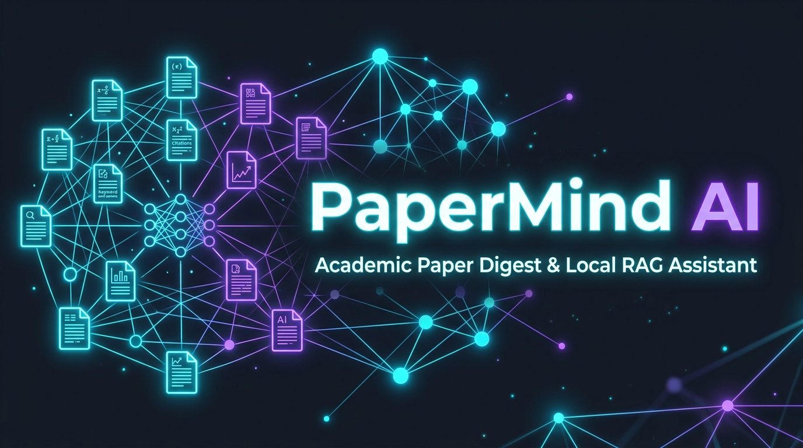
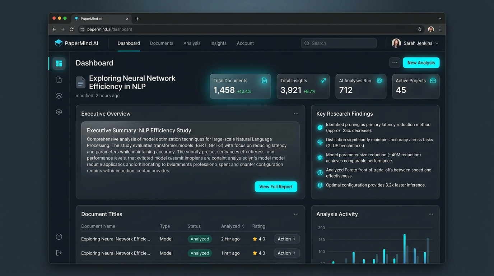
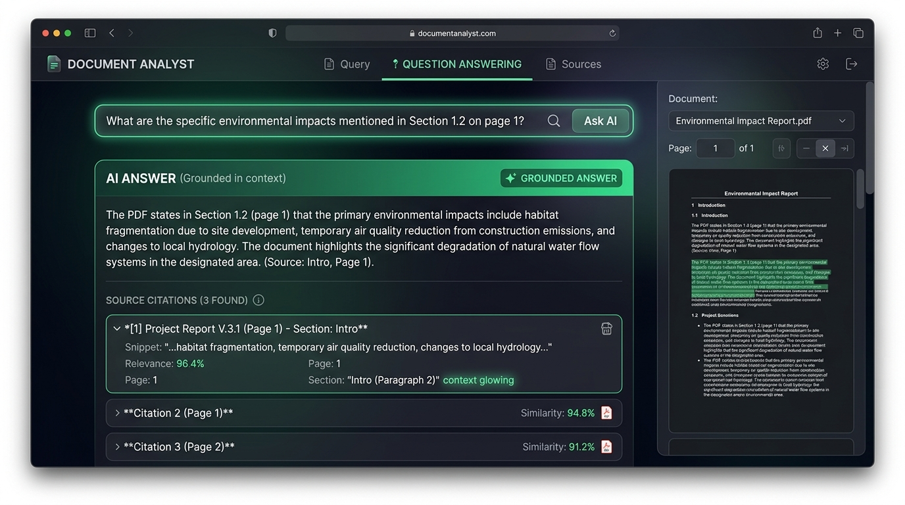
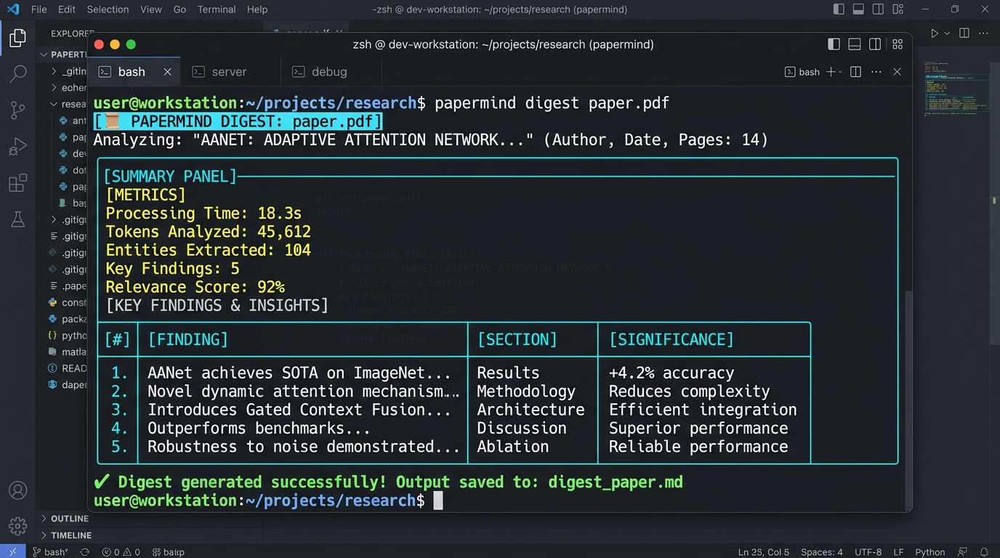
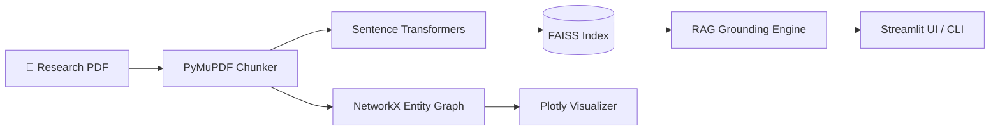

<p align="center">
  
</p>

<h1 align="center">📄 PaperMind AI</h1>
<p align="center">
  <b>An AI-Powered Academic Research Digest, Grounded Local RAG Assistant & Concept Knowledge Graph Extractor</b>
</p>

<p align="center">
  <a href="https://github.com/ashmit044/papermind-ai/actions"></a>
  <a href="https://python.org"></a>
  <a href="https://streamlit.io"></a>
  <a href="https://huggingface.co"></a>
  <a href="https://github.com/facebookresearch/faiss"></a>
  <a href="LICENSE"></a>
</p>

---

## 🌟 Overview

**PaperMind AI** is an open-source, local-first research paper assistant designed for Computer Science students, AI researchers, and developers. Reading long research PDFs can be overwhelming; **PaperMind AI** solves this by automatically parsing papers into structured sections, generating executive digests, indexing document chunks into a dense **FAISS vector store** for grounded RAG Q&A, and extracting interactive **concept co-occurrence knowledge graphs**.

Whether you prefer a terminal command-line tool with rich formatting or a sleek web dashboard, PaperMind AI offers dual interfaces out of the box.

---

## ✨ Core Features

- 📑 **Smart PDF Structure Extraction**: Uses `PyMuPDF` (`fitz`) to parse academic paper sections (*Abstract, Intro, Methods, Experiments, Conclusion*), removing headers/footers and splitting text into overlapping semantic chunks.
- ⚡ **Local Dense Vector Retrieval (RAG)**: Indexes text chunks with `sentence-transformers/all-MiniLM-L6-v2` and `FAISS` for cosine similarity search with exact page and section citations.
- 🔎 **Traceable RAG Answers**: Answers cite retrieved passages inline (`[S1]`), mapped to page and section snippets; missing or unknown citations are clearly flagged.
- 📌 **Executive Paper Summaries**: Generates structured executive digests including key takeaways, methodological novelty, and research limitations.
- 🕸️ **Interactive Concept Knowledge Graph**: Extracts domain concepts and entities into an interactive `NetworkX` & `Plotly` network graph showing central themes and co-occurrence nodes.
- 🖥️ **Dual Interface**:
  - **Streamlit Web Dashboard**: Interactive UI with dark-glassmorphism theme, tabbed navigation, and download options.
  - **Rich CLI Utility**: Powered by `typer` and `rich` for quick command-line batch processing.
- 📤 **Multi-Format Export**: Export digests to clean Markdown reports or structured JSON files.
- 🐳 **Docker & CI Ready**: Full Docker containerization and GitHub Actions workflow for automated linting and unit testing with `pytest`.

---

## 📸 Screenshots

<p align="center">
  
  <br/>
  <i>Streamlit Web Dashboard — Paper Executive Digest & Key Insights</i>
</p>

<br/>

<p align="center">
  
  <br/>
  <i>Grounded RAG Q&A Tab — Querying Papers with Inline Citations</i>
</p>

<br/>

<p align="center">
  
  <br/>
  <i>PaperMind AI Command-Line Interface (`papermind digest`) with Rich formatting</i>
</p>

---

## ⚙️ Installation

### 1. Clone Repository & Setup Environment
```bash
git clone https://github.com/ashmit044/papermind-ai.git
cd papermind-ai

# Create and activate virtual environment
python -m venv venv
# On Windows:
venv\Scripts\activate
# On Linux/macOS:
source venv/bin/activate
```

### 2. Install Dependencies
```bash
pip install -r requirements.txt
pip install -e .
```

### 3. Environment Variables (Optional)
Copy `.env.example` to `.env` if you want to use custom LLM providers like OpenAI or Ollama:
```bash
cp .env.example .env
```

---

## 🚀 Quickstart & Usage

### 🌐 Launch Streamlit Web UI
```bash
streamlit run src/papermind/ui/app.py
```
Open `http://localhost:8501` in your browser.

---

### 💻 Command-Line Interface (CLI)

#### 1. Generate Executive Paper Summary & Export Markdown Report
```bash
papermind digest examples/sample_paper.pdf --md --json
```

#### 2. Query Paper via Grounded RAG
```bash
papermind ask examples/sample_paper.pdf "What memory complexity improvement does the proposed model achieve?"
```

#### 3. Display CLI Version
```bash
papermind version
```

---

## 💡 How It Works



1. **PDF Processing**: `PaperParser` reads PDF byte streams, detects academic section headings via regex, and creates overlapping `TextChunk` models with page metadata.
2. **Dense Vector Indexing**: `VectorIndex` computes 384-dimensional normalized vector embeddings using `all-MiniLM-L6-v2` and adds them to a flat inner-product `FAISS` index.
3. **Retrieval & Synthesis**: `RAGEngine` retrieves top-$K$ semantic matches, constructs grounded context prompts with page attributions, and synthesizes accurate answers.
4. **Graph Construction**: `ConceptGraphExtractor` identifies entity co-occurrences and builds node centrality graphs rendered via Plotly.

---

## 🛠️ Project Structure

```
papermind-ai/
├── .github/
│   └── workflows/
│       └── ci.yml               # GitHub Actions CI pipeline
├── assets/
│   ├── banner.png               # Repository header banner
│   └── screenshots/             # UI and CLI demonstration screenshots
├── docs/
│   ├── ARCHITECTURE.md          # Technical system design specification
│   └── USAGE_GUIDE.md           # Step-by-step user guide
├── examples/
│   └── quickstart.py            # Standalone python usage script
├── src/
│   └── papermind/
│       ├── __init__.py
│       ├── config.py            # Settings & pydantic configuration
│       ├── embeddings.py        # SentenceTransformers + FAISS vector engine
│       ├── graph.py             # NetworkX concept knowledge graph
│       ├── main.py              # Typer + Rich CLI application
│       ├── parser.py            # PyMuPDF parser & section chunker
│       ├── rag_engine.py        # Grounded RAG Q&A synthesizer
│       ├── summarizer.py        # Executive paper summarizer
│       ├── ui/
│       │   └── app.py           # Streamlit Web App dashboard
│       └── utils/
│           ├── exporter.py      # Markdown & JSON digest exporter
│           └── logger.py        # Loguru console logging utility
├── tests/                       # Pytest unit testing suite
│   ├── test_embeddings.py
│   ├── test_parser.py
│   ├── test_rag.py
│   └── test_summarizer.py
├── Dockerfile                   # Production Docker container definition
├── pyproject.toml               # Package build metadata
├── requirements.txt             # Dependency requirements
├── LICENSE                      # MIT License
└── README.md                    # Project documentation
```

---

## 🧰 Libraries & Technologies Used

| Category | Technology |
|---|---|
| **Core Language** | Python 3.12+ |
| **PDF Extraction** | PyMuPDF (`fitz`) |
| **Embeddings** | `sentence-transformers` (`all-MiniLM-L6-v2`) |
| **Vector Indexing** | `faiss-cpu` |
| **Data & Graphing** | `numpy`, `pandas`, `networkx`, `plotly` |
| **Web UI** | `streamlit` |
| **CLI & Formatting** | `typer`, `rich`, `loguru` |
| **Testing & CI** | `pytest`, `pytest-cov`, `ruff`, `black` |

---

## 🧪 Testing & Verification

Run the test suite with `pytest`:
```bash
pytest --cov=src/papermind tests/
```

Check formatting and linting:
```bash
ruff check src tests
black --check src tests
```

---

## 🔮 Future Improvements

- [ ] Add OCR support via `pytesseract` for scanned PDF papers.
- [ ] Integrate arXiv API for direct search and auto-downloading papers by ID.
- [ ] Expand concept graph extraction using Named Entity Recognition (NER) models (`spaCy`).
- [ ] Add PDF visual canvas annotation overlays for retrieved RAG bounding boxes.

---

## 🤝 Contributing

Contributions, issues, and feature requests are welcome! Feel free to check out the [Issues](https://github.com/ashmit044/papermind-ai/issues) page.

1. Fork the Project
2. Create your Feature Branch (`git checkout -b feature/AmazingFeature`)
3. Commit your Changes (`git commit -m 'feat: Add some AmazingFeature'`)
4. Push to the Branch (`git push origin feature/AmazingFeature`)
5. Open a Pull Request

---

## 📄 License

Distributed under the MIT License. See [`LICENSE`](LICENSE) for details.

---

## 👨‍💻 Author

**Ashmit**
- GitHub: [@ashmit044](https://github.com/ashmit044)
- Portfolio / CS AI Student Projects

---

## 🙏 Acknowledgements

- [PyMuPDF](https://github.com/pymupdf/PyMuPDF) for fast PDF text extraction.
- [SentenceTransformers](https://www.sbert.net/) for powerful open embeddings.
- [FAISS](https://github.com/facebookresearch/faiss) by Meta AI Research for fast vector similarity search.
- [Streamlit](https://streamlit.io/) for rapid dashboard prototyping.
