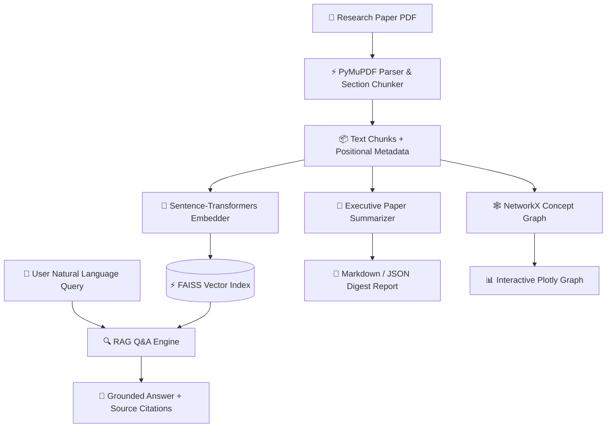

# 🏗️ PaperMind AI — Architecture Specification

This document details the system design, data flow, and modular architecture of **PaperMind AI**.

---

## 📐 System Design Overview

---

## 🧩 Core Modules

### 1. Document Parsing & Section Chunking (`papermind.parser`)
- Uses **PyMuPDF (`fitz`)** for high-performance PDF page rendering and text extraction.
- Cleans page noise (headers, footers, pagination).
- Identifies section headings (*Abstract, Introduction, Methodology, Results, Conclusion, References*) via regular expression patterns.
- Splits document into overlapping chunks (default: 500 chars with 50 char overlap) preserving section and page metadata.

The dashboard parses uploaded PDF bytes in memory instead of persisting the original file in the cache.

### 2. Embeddings & Vector Indexing (`papermind.embeddings`)
- Powered by `sentence-transformers/all-MiniLM-L6-v2` producing 384-dimensional dense vectors.
- Leverages **FAISS (`faiss-cpu`)** using Inner Product search over normalized embeddings (equivalent to Cosine Similarity).

### 3. RAG Q&A Grounding (`papermind.rag_engine`)
- Queries FAISS index for top-$K$ semantic matches.
- Builds grounded context prompts with stable source labels, exact page number, and section attributions. Generated answers should cite those labels inline; unknown or omitted citations are flagged for review.
- Treats retrieved document text as untrusted input and instructs LLM providers not to follow instructions embedded in papers.
- Supports pluggable backends:
  - **Offline Synthesizer**: Fast standalone extraction without requiring API keys.
  - **Ollama**: Local `llama3` LLM execution.
  - **OpenAI**: `gpt-3.5-turbo` endpoint.
- The OpenAI backend receives retrieved text context; users should avoid selecting it for sensitive documents unless that data flow is acceptable.

### 4. Executive Paper Digest (`papermind.summarizer`)
- Extracts executive overview, core methodology, and key takeaways.
- Identifies quantitative claims and novel contributions.

### 5. Concept Knowledge Graph (`papermind.graph`)
- Extracts technical terms, acronyms, and domain concepts.
- Builds a **NetworkX** co-occurrence graph.
- Renders interactive HTML/Plotly network visualizations showing node centrality.

---

## 🛠️ Design Patterns Applied
- **Dependency Injection**: RAG Engine accepts abstract vector index implementations.
- **Factory / Strategy Pattern**: Multi-backend LLM provider selection (`offline`, `ollama`, `openai`).
- **Data Transfer Objects (DTOs)**: Structured type-checked models via `Pydantic`.
